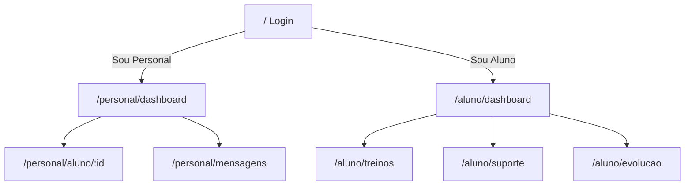

# Planejamento do mock YellowBlack Gym

Fonte: [agentes/gym_architecture.md](agentes/gym_architecture.md). Escopo: UI navegável com dados em memória, sem backend, banco ou IA real.

## Stack

- Angular (standalone, roteamento nativo)
- Tailwind CSS com tokens do design system (fundo `#121212`, cards `#1E1E1E`, destaque `#FACC15`, texto `#FFFFFF` / `#A0A0A0`)
- Lucide Angular para ícones
- Chart.js para gráficos de evolução
- Dados em `src/app/core/mock/` + serviços reativos que leem/escrevem no `sessionStorage` (login, checklists, mensagens, fichas)

## Rotas

Guard simples: se não houver sessão, redirecionar para `/`. Personal não acessa `/aluno/*` e vice-versa.

## Mock de autenticação

- Login aceita qualquer e-mail/CPF + senha não vazia
- Radio **Sou Aluno** / **Sou Personal** define o papel
- Sessão: `{ role, name, studentId? }`
- Para aluno, mapear e-mail conhecido aos 5 cadastros (ex.: `ana@gym.com`, `carlos@gym.com`, `beatriz@gym.com`, `marcos@gym.com`, `juliana@gym.com`). Fallback: Ana Clara
- Personal: nome fixo "Marcos Trainer"

## Dados mock (5 alunos)

Reproduzidos fielmente em `students.mock.ts`:

- Plano e dias restantes (Ana/Marcos trimestral 45d, Carlos/Juliana mensal 18d, Beatriz diário 1d)
- Meta + observação clínica no banner sticky
- Grade semanal (fichas por dia)
- Lista de exercícios do dia (séries, reps, carga)
- Evolução (cargas/medidas em 6 pontos no tempo)

## Telas

**Login:** fundo preto, logo amarela, inputs, radios de papel, botão "Entrar no Treino".

**Personal — dashboard:** header "Olá, Treinador …", filtro Seg–Dom, cards com foto/iniciais, nome, status Treinou hoje / Ausente.

**Personal — aluno:** header (nome, idade, plano), banner amarelo sticky com meta/cuidado, abas "Ficha de Treino" (com construtor de treino) e "Evolução de Cargas" (com seletor de exercícios, métricas de ganho, gráfico Chart.js e histórico completo de progressão do aluno).

**Personal — mensagens:** lista dos 5 alunos + thread mock (texto pré-carregado + envio local).

**Aluno — dashboard:** widget de plano com barra amarela, card "Treino de hoje" (com checklist "Feito", botão de evolução de carga inline/modal e feedback dinâmico), resumo de melhorias recentes de carga.

**Aluno — treinos:** visão semanal + histórico simples dos últimos treinos.

**Aluno — suporte:** toggle "Falar com meu Personal" vs "GymBot". GymBot responde com regras locais (ex.: stiff, leg press) + card de vídeo YouTube (thumbnail/link). Chat do PT é a mesma thread vista pelo personal, filtrada pelo `studentId`.

**Aluno — evolução:** seletor de exercício (dropdown + pílulas rápidas), cards com métricas de ganho de força, gráfico de linha amarelo dinâmico (Chart.js) por exercício e linha do tempo de melhorias registradas.

## Sistema de Evolução de Cargas

- Dados centralizados no `GymStore` com reatividade de Signals e sincronização no `sessionStorage` (`ybg.progressions`).
- Exemplos mock para Carlos Eduardo (Rosca direta 26kg ➔ 28kg ➔ 30kg ➔ 35kg, Remada curvada 60kg ➔ 65kg ➔ 70kg, Supino reto) e Ana Clara (Hip thrust, Agachamento smith).
- Sincronização mútua: o que o aluno registra em seu treino ou na tela de evolução reflete instantaneamente para o Personal Trainer.

## Layout compartilhado

- Shell dark com sidebar desktop e bottom nav mobile
- Personal: Alunos, Mensagens, Sair
- Aluno: Hoje, Treinos, Evolução, Suporte, Sair
- Responsivo: cards empilhados no mobile, grid no desktop

## Validação e Execução

- Servidor de desenvolvimento: `http://localhost:4200`
- Build de produção verificado com sucesso (`ng build`).
